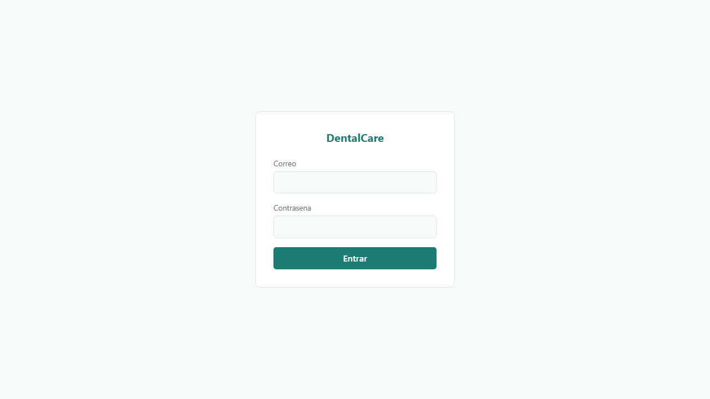
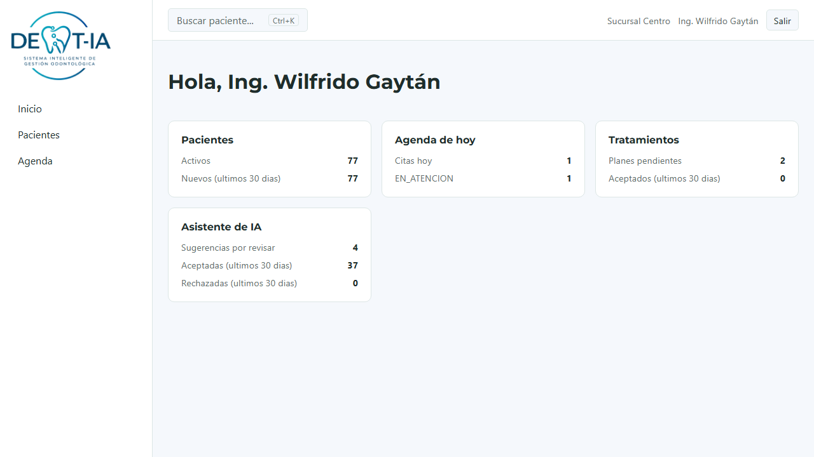
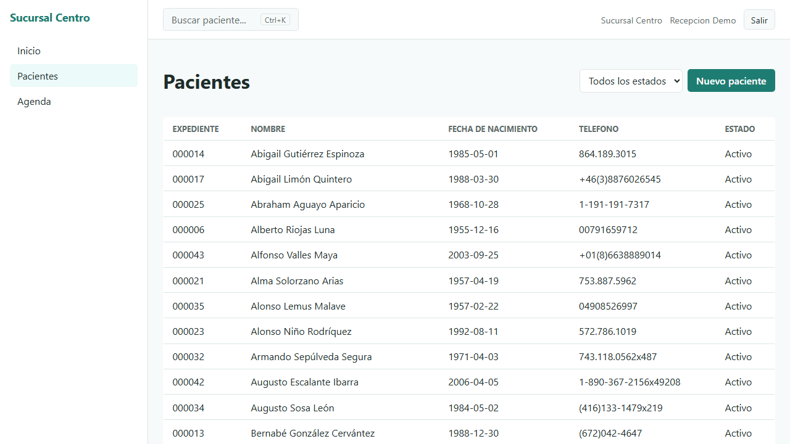
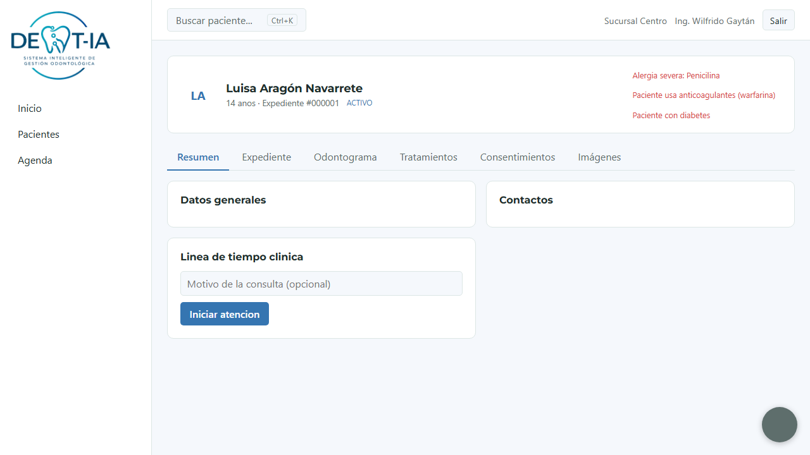
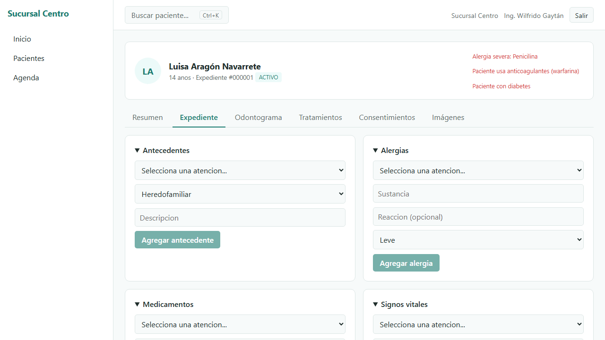
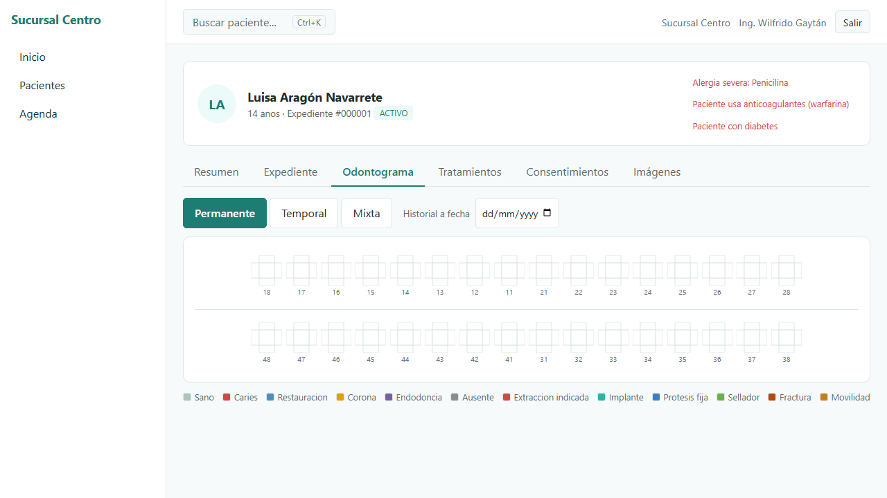
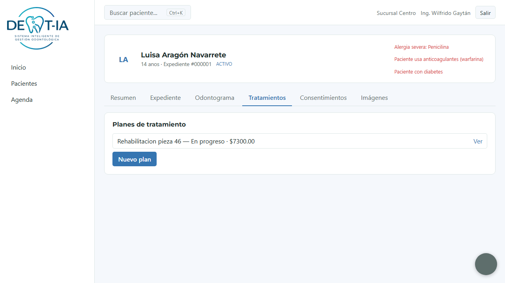
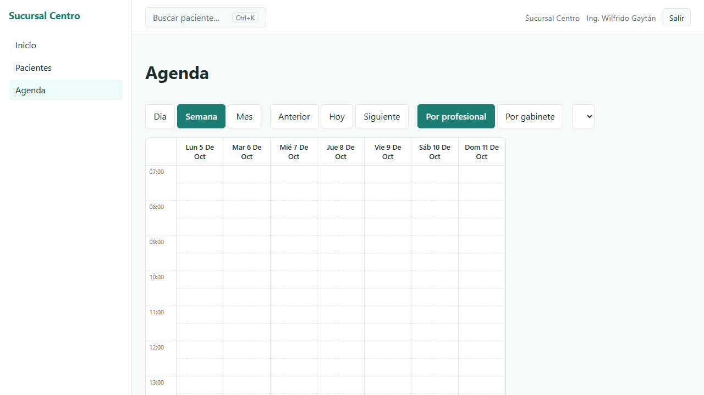
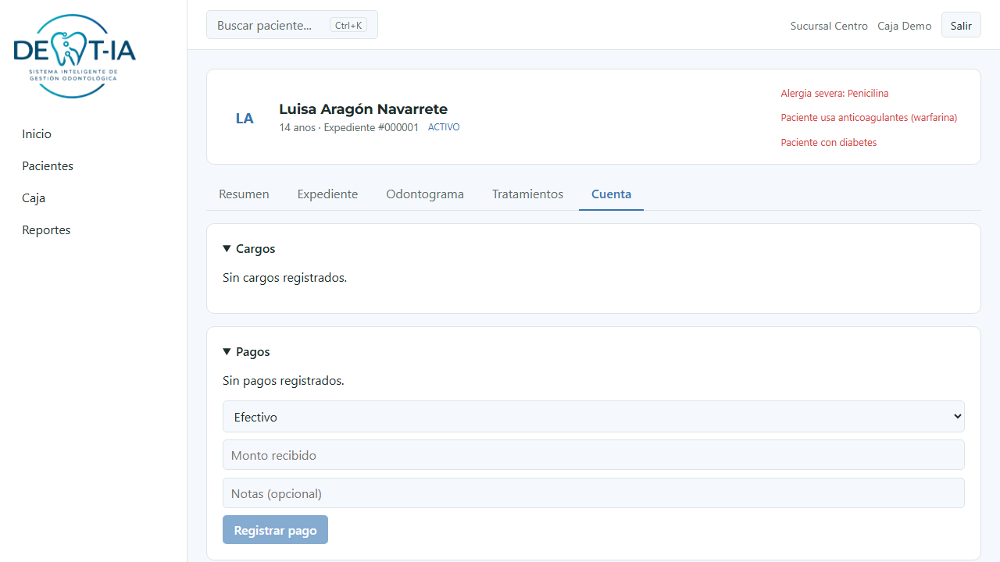
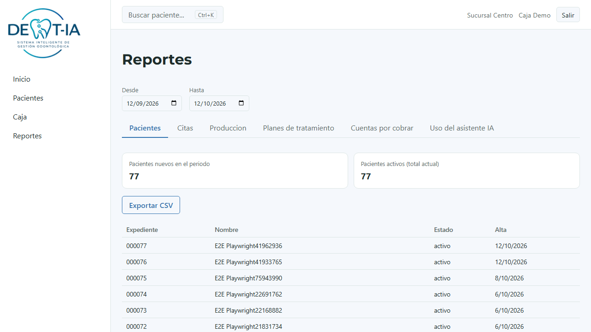

# Manual de usuario — DentalCare

Guía para el personal de la clínica (no para desarrolladores: la parte técnica está en
[`docs/MANUAL_TECNICO.md`](./MANUAL_TECNICO.md)). Las capturas son de los datos de
ejemplo (ficticios) que crea `python -m app.seed` — con datos reales la pantalla se ve
igual, solo cambia la información.

## 1. Entrar al sistema

Abre la dirección que te dé tu clínica (en una instalación local,
`http://localhost:5174`). Escribe tu correo y contraseña y presiona **Entrar**.

Si tu rol es **Administrador de la clínica**, el sistema puede pedirte configurar un
segundo paso de seguridad (MFA, con una app como Google Authenticator) la primera vez
que entras — por el momento está desactivado temporalmente, así que no debería
aparecer (ver `docs/SEGURIDAD.md`).

Si olvidaste tu contraseña, pide a un **Administrador de la clínica** que te cree una
nueva desde Usuarios — todavía no hay un flujo de "olvidé mi contraseña" por correo.

## 2. El tablero de inicio

Al entrar ves tu **tablero de inicio**, distinto según tu rol: cada tarjeta (Pacientes,
Agenda de hoy, Tratamientos, Asistente de IA, Cobranza) solo aparece si tu rol puede ver
esa información. Un odontólogo, por ejemplo, no ve la tarjeta de cobranza.

El menú de la izquierda también cambia según tu rol: ahí solo aparecen las secciones a
las que tienes acceso (Pacientes, Agenda, Usuarios, Caja, Reportes, Configuración...). El
logo de la clínica (o su nombre, si no tiene logo configurado) arriba a la izquierda es
un enlace: haz clic ahí para volver al tablero de inicio desde cualquier pantalla.

## 3. Buscar un paciente

Desde cualquier pantalla, presiona **Ctrl+K** (o haz clic en "Buscar paciente...") para
abrir la búsqueda rápida. Puedes buscar por nombre, teléfono, correo o número de
expediente, aunque escribas el nombre con errores o sin acentos.

## 4. Pacientes

### 4.1 Listado y alta de un paciente nuevo

La pantalla "Pacientes" lista a todos con un filtro por estado. Si tu rol puede dar de
alta pacientes (recepción o administrador de la clínica), verás el botón **Nuevo
paciente**. Si tu rol es odontólogo o especialista, además verás la casilla **Mis
pacientes**: muestra solo los que te tienen asignado como profesional tratante.

Dar de alta a un paciente tiene 3 pasos:
1. **Datos** — nombre, apellidos y fecha de nacimiento son obligatorios; el resto
   (teléfono, correo, dirección, sexo, profesional tratante y gabinete por defecto) es
   opcional. Elegir aquí un profesional y un gabinete hace que la Agenda los proponga
   solos la próxima vez que se agende una cita para este paciente (sección 6).
2. **Posibles duplicados** — si ya existe un paciente con un nombre parecido y la misma
   fecha de nacimiento o teléfono, el sistema te muestra la coincidencia antes de seguir,
   para no duplicar un expediente. Si de verdad es una persona distinta, confirma
   "Ninguno es el mismo paciente, continuar".
3. **Contactos** — un tutor o un contacto de emergencia (opcional, se puede agregar
   después).

### 4.2 La ficha del paciente

Al abrir un paciente ves un encabezado que **siempre está visible** sin importar la
pestaña en la que estés: nombre, edad, número de expediente y, a la derecha, las
**alertas críticas** (alergias, medicamentos de riesgo, antecedentes relevantes) en rojo
— se calculan solas a partir del expediente, no las escribe nadie a mano.

Debajo del encabezado hay pestañas:

- **Resumen** — datos generales, contactos y la línea de tiempo clínica (todas las
  atenciones del paciente). Desde aquí se abre una atención nueva con **Iniciar
  atención** (o desde una cita en la Agenda, sección 6). Si tu rol puede editar al
  paciente, también puedes cambiar su profesional tratante o su gabinete por defecto —
  como cualquier cambio de este tipo, el sistema te pide un motivo antes de guardarlo.
- **Expediente** — antecedentes, alergias, medicamentos, signos vitales, diagnósticos y
  las notas clínicas (ver sección 5).
- **Odontograma** — el estado de cada pieza dental (sección 5.3).
- **Tratamientos** — planes de tratamiento, presupuestos y procedimientos (sección 5.4).
- **Consentimientos** — plantillas y consentimientos firmados (sección 5.5).
- **Imágenes** — fotografías y radiografías (sección 5.6).
- **Cuenta** — cargos y pagos (solo si tu rol puede ver cobranza; sección 7).

## 5. Atender a un paciente

### 5.1 Expediente

Cada sección (antecedentes, alergias, medicamentos, signos vitales, diagnósticos) tiene
su propio selector **"Atención"** — todo lo que registras queda ligado a una atención
concreta, nunca "suelto". Si el paciente ya tiene una atención de hoy, se preselecciona
sola; si no tiene ninguna, el selector ofrece **"+ Iniciar atención nueva"**, que la crea
ahí mismo sin salir de la pantalla (el mismo selector se comparte con Tratamientos y
Consentimientos, así que una vez elegida o creada, aplica en toda la ficha del paciente).

Cada sección se puede abrir o cerrar por separado. Cualquier alergia activa, y ciertas
palabras clave en
medicamentos o antecedentes (por ejemplo "diabetes", "anticoagulantes", "marcapasos"),
generan una alerta crítica — el sistema **siempre** la muestra antes de dejarte recetar,
finalizar una nota o registrar un procedimiento, nunca se puede ignorar en silencio.

### 5.2 La nota clínica (SOAP)

Al iniciar una atención se abre una nota clínica con el formato SOAP (Subjetivo,
Objetivo, Análisis, Plan) y se guarda sola cada 10 segundos mientras escribes, para no
perder el avance. Una nota pasa por estos estados:

- **Borrador** — se puede seguir editando.
- **Finalizada** — una vez que presionas **Finalizar nota**, queda congelada: ya no se
  puede editar ni borrar. Es una regla del sistema, no una limitación de permisos.
- **Corregida** — si una nota finalizada tenía un error, no se edita: se crea una
  **versión nueva** con el motivo de la corrección, y las dos versiones quedan
  guardadas (la original nunca se pierde).
- **Cancelada** — con motivo, si la atención completa no debía existir (no se borra, se
  anula).

Si el paciente dicta en voz alta durante la consulta, el asistente de IA (micrófono,
`Alt+M`) puede proponer datos para la nota, el odontograma o el plan — ver sección 8:
**nunca** escribe nada él solo, siempre tienes que revisar y aceptar cada propuesta.

### 5.3 Odontograma

Cada pieza dental se identifica con la notación FDI (dos dígitos: cuadrante + posición,
por ejemplo "36" es el primer molar inferior izquierdo). Haz clic en una superficie de
la pieza para registrar un hallazgo (caries, restauración, corona, ausente, etc. — la
leyenda de abajo explica cada color). Tres vistas:

- **Permanente** — solo dientes de adulto.
- **Temporal** — solo dientes de leche.
- **Mixta** — ambos a la vez (dentición mixta en niños).

El control "Historial a fecha" reconstruye cómo se veía el odontograma en cualquier
fecha pasada — nada se sobrescribe, cada hallazgo nuevo queda en el historial.

### 5.4 Diagnóstico y plan de tratamiento

Un plan de tratamiento se organiza en **fases**, y cada fase tiene procedimientos
(pieza, superficie, precio del catálogo de la clínica). El flujo:

1. Crear el plan y agregar procedimientos → queda **planificado**.
2. **Presentar al paciente** → genera el presupuesto en PDF con el logo de la clínica.
3. El paciente **acepta** (total o parcialmente) — esto queda registrado con su nombre y
   la fecha, pero **no es un pago**: aceptar un presupuesto no cobra nada todavía.
4. Al **realizar** el procedimiento, se marca como tal en el odontograma y genera
   automáticamente un cargo "sugerido" para cobranza (sección 7).

Importante: lo planificado y lo realizado son cosas separadas en el sistema — un
procedimiento planificado que todavía no se hizo nunca se confunde con uno ya hecho.

### 5.5 Consentimientos

Antes de un procedimiento que lo requiera (una extracción, una endodoncia...), el
paciente firma un consentimiento en la pantalla (con el dedo o el mouse, sobre una
plantilla de texto configurable). Al firmar se genera un PDF con un identificador
(hash) único — **ese PDF ya no se puede modificar**; si el consentimiento cambia, se
firma uno nuevo.

### 5.6 Imágenes y radiografías

Puedes subir una o varias fotos/radiografías a la vez (intraoral, extraoral,
periapical, bitewing, panorámica, cefalometría). El visor permite hacer zoom y ajustar
brillo/contraste sin modificar el archivo original. Cada vez que alguien abre una
imagen, queda registrado quién y cuándo (igual que al abrir el expediente completo).

## 6. Agenda

La Agenda es una pantalla propia del menú lateral (no es parte de la ficha del
paciente, porque una cita es de la clínica/profesional). Puedes ver el día, la semana o
el mes, y agrupar por profesional o por gabinete. Para agendar: haz clic en un espacio
libre, busca al paciente y confirma.

- **Arrastrar una cita** la reprograma — el sistema crea una cita nueva en el horario
  nuevo y marca la anterior como "Reprogramada" (no se pierde el historial).
- El sistema avisa si una cita cae fuera del horario laboral o choca con otra del mismo
  profesional, pero no te impide guardarla si de verdad es necesario.
- El botón **Iniciar atención** sobre una cita del día de hoy abre directamente la nota
  clínica de esa atención.

## 7. Caja y cobranza

En la pestaña "Cuenta" de un paciente ves sus cargos (generados al realizar un
procedimiento) y sus pagos. Un pago puede ser en efectivo, tarjeta o transferencia, y
se puede aplicar completo a un cargo, repartido entre varios, o dejarse como anticipo.
El saldo y el estado de cada cargo (pendiente/pagado) se calculan siempre contra los
pagos reales — nunca se guardan "a mano".

La pantalla **Caja** permite abrir y cerrar una sesión de cobro (un turno), con el total
esperado por cada método de pago contra lo que de verdad se cobró.

> Si tu clínica no cobra directamente (por ejemplo, una clínica universitaria de
> práctica), un administrador puede desactivar la cobranza desde Configuración → Cobranza
> sin perder el registro de qué se hizo — solo deja de pedir el pago.

## 8. Asistente de IA por voz

Dentro de la pantalla de Atención, el botón de micrófono (`Alt+M`) grava tu dictado,
lo transcribe en el propio equipo (no sale de la clínica ni se manda a internet) y
propone acciones concretas: motivo de consulta, signos vitales, un hallazgo nuevo en el
odontograma, un procedimiento planificado o realizado, agregar texto a la nota, o
proponer una cita de control.

**El asistente nunca guarda nada por sí solo.** Cada propuesta aparece en un panel para
que la revises y decidas, una por una:
- **Aceptar** — se aplica tal cual al expediente/odontograma/plan.
- **Editar y aceptar** — corriges el dato antes de guardarlo.
- **Rechazar** — se descarta.

Todo lo que viene de una propuesta aceptada queda marcado en el sistema como asistido
por IA, con el modelo y la fecha — se puede distinguir de lo que escribiste a mano
consultando la bitácora de auditoría de esa atención.

Si el servicio de IA no está disponible (apagado o no instalado), el resto del sistema
sigue funcionando normal: el dictado se puede insertar igual como texto libre en la
nota, solo sin las propuestas automáticas.

## 9. Reportes

Solo visible para quien tenga el permiso correspondiente (normalmente administración y
caja). Seis reportes de solo lectura con exportación a CSV: pacientes nuevos/activos,
citas y tasa de inasistencia, producción por profesional, planes de tratamiento, cuentas
por cobrar y uso del asistente de IA. Cada reporte (salvo "Cuentas por cobrar", que es
una fotografía del saldo actual) acepta un rango de fechas; por defecto muestra los
últimos 30 días. Exportar un reporte queda registrado en la bitácora de auditoría.

## 10. Configuración → Catálogos

Solo visible para un administrador de la clínica (Configuración → Catálogos). Aquí se
administran, por sucursal, las listas que antes solo podía cambiar quien programó el
sistema: tipos de consulta/cita, hallazgos del odontograma, diagnósticos, categorías de
antecedentes, palabras clave de alerta (de antecedentes y de medicamentos),
procedimientos y precios, gabinetes y los datos básicos de la propia sucursal.

Cada catálogo tiene su propia pestaña con una tabla y un formulario para agregar un
elemento nuevo (código interno en minúsculas sin espacios, nombre visible y, según el
catálogo, algún dato adicional — por ejemplo la duración por defecto y el color de un
tipo de cita, o si un hallazgo exige indicar una superficie del diente).

- **Un elemento nuevo queda disponible de inmediato.** Por ejemplo, si agregas el tipo
  de cita "Valoración ortodoncia" con 45 minutos de duración, ya aparece en el selector
  al agendar una cita — no hace falta reiniciar nada ni esperar.
- **Desactivar no borra.** Un hallazgo o tipo de cita desactivado deja de aparecer en los
  menús para elegir uno nuevo, pero los registros que ya lo usaron (una nota, una cita
  pasada, un hallazgo en el odontograma) lo siguen mostrando tal cual — el historial
  clínico no cambia nunca por una desactivación (regla 2 de uso del sistema: nada se
  borra de verdad).
- El código interno de un elemento no se puede cambiar una vez creado (evita que una
  cita o un hallazgo antiguo apunten, sin darse cuenta, a otra cosa); si lo necesitas,
  desactiva el elemento y crea uno nuevo con el código correcto.
- **Exportar e importar por CSV** (botones arriba de cada tabla): exportar descarga
  el catálogo completo, incluidos los desactivados. Al reimportar, cada fila con el
  mismo código actualiza ese elemento (nunca lo borra) y una fila con un código nuevo
  lo crea; si una fila tiene un error (código inválido, nombre vacío), se te avisa
  cuál fue y el resto del archivo se importa igual — no hace falta corregir el CSV
  entero por un solo error.
- **Pestaña "Gabinetes":** agregar, renombrar y activar/desactivar los gabinetes de
  la sucursal — igual que con los demás catálogos, uno desactivado deja de ofrecerse
  al agendar pero las citas que ya lo usaron lo siguen mostrando.
- **Pestaña "Sucursal":** editar el nombre, dirección y teléfono de tu propia
  sucursal. No sirve para dar de alta una sucursal nueva ni para editar otra
  distinta a la que tienes seleccionada — eso lo sigue administrando quien opera el
  sistema completo.

## 12. Dentia (asistente de voz) — en construcción

Si tu rol es odontólogo, especialista o recepción, verás un pequeño círculo ("el
orbe") en la esquina inferior derecha de la pantalla: es Dentia, el asistente de voz
manos libres. Dile **"Dentia"** en voz alta para activarla.

Lo que ya puedes hacer por voz:
- **Navegar:** "Dentia, abre el expediente de Juan Pérez", "ve a la agenda",
  "abre el odontograma", "¿qué citas tengo hoy?", "¿tiene alergias?" (si tu rol
  incluye acceso clínico).
- **Iniciar la consulta:** "Dentia, inicia la consulta" — retoma la cita de hoy
  o crea una atención nueva, y te lee las alertas críticas del paciente antes de
  empezar. Te pide confirmar con un "sí".
- **Dictar hallazgos del odontograma**, una vez iniciada la consulta: "la 18
  caries oclusal", "la 36 ausente"... Dentia repite lo que va a hacer y lo
  aplica a los 3 segundos — si te equivocaste, di **"cancela"** antes de que
  pase ese tiempo. Puedes seguir dictando pieza tras pieza sin repetir
  "Dentia": mientras sigas hablando, te sigue escuchando (unos 8 segundos de
  silencio y vuelve a esperar a que digas su nombre).
- **Deshacer lo último:** "Dentia, deshaz" — quita el último hallazgo que
  aplicó (no borra el historial, solo lo marca como ya no vigente).
- **Diagnóstico y procedimientos**, una vez iniciada la consulta:
  - "Dentia, pon un diagnóstico de pulpitis reversible en la treinta y seis"
    (o "diagnóstico: caries profunda", sin pieza si no aplica).
  - "Dentia, planea una resina en la 36" (o "procedimiento planeado...") —
    lo agrega al plan de tratamiento, creando uno nuevo si el paciente no
    tiene todavía.
  - "Dentia, hice una limpieza" (o "procedimiento realizado...", "termine
    la...") — lo registra como ya realizado.
  - Todas piden confirmar con un "sí". Si no reconoce el procedimiento del
    catálogo de la sucursal, te lo dice en vez de adivinar.
- **Agenda, si tu rol es recepción (u odontólogo/especialista):**
  - "Dentia, agenda a María López el jueves a las 11 con la doctora Ruiz,
    limpieza" — pide confirmar con un "sí". Si no dices la hora, Dentia te
    propone horarios reales de esa doctora ese día ("tiene libre a las 10:00
    y a las 12:30") para que repitas la orden con la que prefieras.
  - "Dentia, cuándo hay espacio con la doctora Ruiz esta semana" — consulta
    disponibilidad sin agendar nada.
  - "Dentia, confirma la cita de María López" (o "de las 10").
  - "Dentia, llegó María López" — la pasa a sala de espera.
  - "Dentia, mueve la cita de María López al viernes" (a la misma hora si no
    dices una nueva) — pide confirmar con un "sí".
  - "Dentia, cancela la cita de las 12, motivo: enfermedad" — el motivo es
    obligatorio en la misma frase. "Dentia, María López no llegó" (o "no se
    presentó") la marca como no-show.
  - "Dentia, agrega a María López a la lista de espera" (o, justo después de
    mencionarla, solo "agrégala a la lista de espera").
  - "Dentia, registra paciente nuevo Pedro Sánchez, teléfono 555 123 4567" —
    abre el formulario de alta con esos datos ya escritos; tú lo terminas y
    confirmas en pantalla (Dentia nunca crea el paciente por su cuenta).
  - Si el horario que pides ya está ocupado, Dentia te lo dice y te pide otra
    hora — nunca agenda una cita encimada con otra.
- **Frases libres y dictado**, una vez iniciada la consulta: si dices algo
  que Dentia no reconoce con sus frases de siempre, intenta entenderlo igual
  (por ejemplo "la paciente me dice que es alérgica a la penicilina") y te
  pregunta "¿confirmas?" antes de aplicarlo — puede tardar un poco más y te
  avisa con "un momento...". Para dictar varias cosas de
  seguido, di **"Dentia, dictado"**, habla todo lo que necesites sin pausas
  especiales, y termina con **"fin del dictado"**: te dice cuántas
  propuestas entendió y te pregunta si las acepta todas. Si dices "no",
  quedan guardadas en el panel de Propuestas para revisarlas con calma.

Dentia sigue aprendiendo cosas nuevas — lo que todavía no reconoce con una
frase de siempre, inténtalo igual: puede que lo entienda por su ruta más
lenta (frases libres y dictado, arriba), o te dirá que no puede.

- El color del orbe indica su estado: gris (escuchando en segundo plano), azul
  (te está escuchando), morado (pensando), verde (hablando), ámbar (esperando
  tu confirmación), rojo (apagado o sin conexión).
- Clic en el orbe, o `Alt+M`, lo silencia/reactiva.
- Si abres el sistema en varias pestañas a la vez, solo una tiene el micrófono
  activo — las demás muestran el orbe apagado con la indicación "activo en otra
  pestaña".
- Dentia nunca graba ni guarda el audio; solo lo procesa en el momento, lo
  necesario para reconocer su nombre y entender tu orden.

## 13. Preguntas frecuentes

**¿Por qué no puedo editar una nota que ya finalicé?**
Es una regla del sistema: una nota finalizada no se modifica, para proteger el historial
clínico. Usa "Corregir" — crea una versión nueva con el motivo del cambio, sin perder la
original.

**¿Por qué no veo el botón para dar de alta un paciente / registrar un pago / etc.?**
Depende de tu rol. Pide a un administrador de la clínica que revise tus permisos si
crees que deberías tenerlo (ver `docs/MATRIZ_PERMISOS.md` para la lista completa).

**Acepté una propuesta de la IA por error. ¿Puedo deshacerla?**
No hay un botón "deshacer": corrige el dato manualmente donde haya quedado (la nota, el
odontograma, el plan) igual que corregirías un error propio.

**El asistente de IA no responde.**
Revisa con quien administre el sistema si Ollama (el servicio de IA local) está
encendido — Configuración → Asistente IA muestra su estado. Mientras tanto, puedes
seguir dictando el texto libre a mano en la nota.
